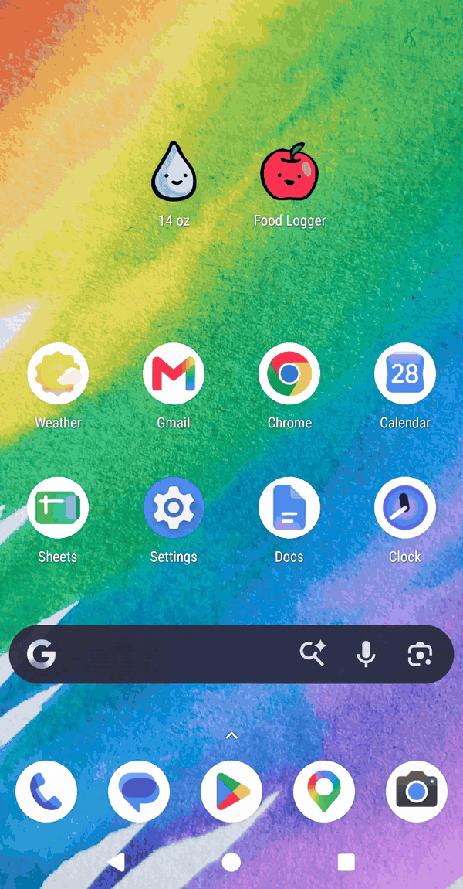
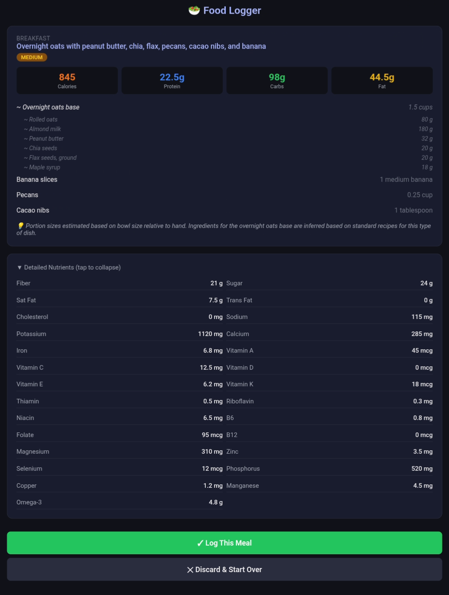
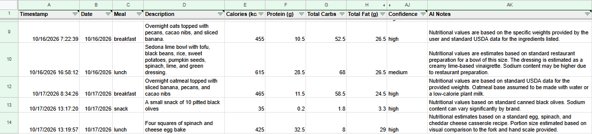
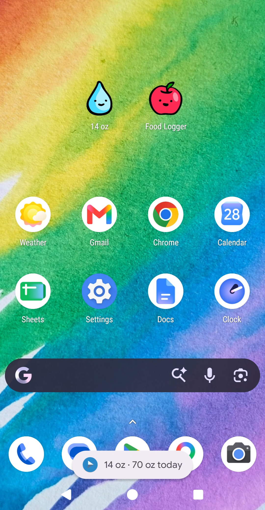
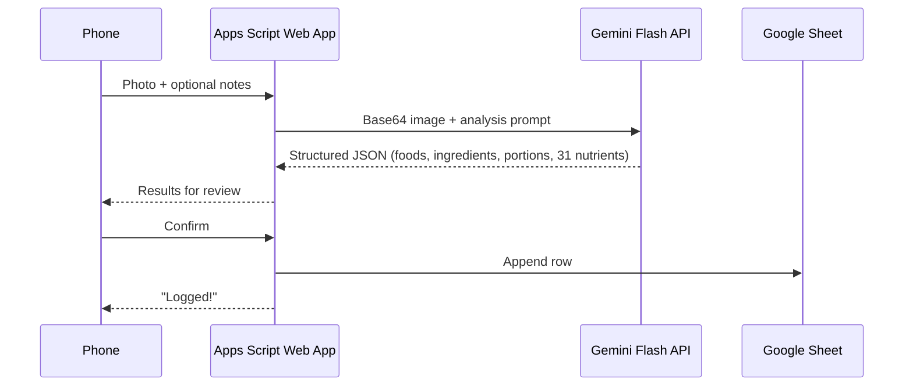

# sheets-ai-nutrient-logger

One-tap water logging and AI-powered food-photo nutrient logging, written straight into my own Google Sheet. It's built on Google Apps Script and the Gemini vision API, and it's free to run (on the Gemini Developer API free tier) or costs pennies a month to run (on the Gemini Developer API paid tier).

This is a personal tool, not a hosted service, so there's no live demo. The web app writes to my own spreadsheet behind a secret key. The GIF below shows the food logging flow.

## What It Does

### Food Logging

*Opening the logger from the home screen, photographing a meal, and reviewing the estimate (sped up in places).*

I take or pick a photo, preferably with my hand or something in it to demonstrate scale, and optionally add a note ("sedona lime bowl at Honest Mary's"). Gemini identifies each food, lists the ingredients of mixed dishes, estimates portions, and returns calories plus 30 other nutrients. I review the results, then one tap logs a row.

  

### Water Logging

One tap on an Android home-screen widget appends a row to the sheet and shows a toast with my running total for the day (`14 oz · 70 oz today`). No browser opens.

  

## Why I Built It

Every logging app I tried proved unsustainable to use long-term. All options took too many taps, required manually exporting my data (if allowing exports at all), and required a pricey subscription fee to get the full set of functionality that I wanted without ads (if they even offered it). In most cases, I wanted the data in a Google Sheet that I own, where I can analyze it alongside my other health data. I also wanted it to be free.

## Architecture

Food logging takes two round trips, analysis then confirmation. Water logging is a single request: the HTTP Shortcuts widget calls the web app, which appends a row and returns the toast text.

| Component | Cost |
|---|---|
| Apps Script hosting, Google Sheets | Free |
| Gemini 3.1 Flash-Lite, per meal (~2,400–2,750 input / ~700–1,000 output tokens, measured) | Free on the free Gemini Developer API pricing tier,[^1] ~$0.002/meal on the paid tier |
| **Total at 3 meals/day** | **$0 (free tier) / ~$0.15–0.20/month (paid tier)** |

## Design Decisions

### Shared

**Narrowing the OAuth scope.** The first deploy asked for access to *all* my Google Sheets. Adding `/** @OnlyCurrentDoc */` limits the script to the one spreadsheet it's attached to.

**No secrets or personal details in source.** The Gemini API key, model name, URL gatekeeper key, and my hand measurement (used as a scale reference) all live in Script Properties. Switching Gemini models means editing a property without needing to redeploy code.

### Water Logging

**One-tap water logging without building an app.** Google doesn't offer a Sheets widget that appends a row. Instead, the Apps Script project is deployed as a web app, and the open-source [HTTP Shortcuts](https://github.com/Waboodoo/HTTP-Shortcuts) app calls it from a home-screen widget. The result is one tap, no browser, and no ads.

**The "0 oz today" bug.** Initially, the water toast always reported 0 oz for the day, not even including the current volume being logged in the daily total. There were two causes:
1. The script's time zone and the spreadsheet's time zone differed slightly, so comparing exact midnight timestamps never matched. Now every date is formatted as a `yyyy-MM-dd` string in the spreadsheet's own time zone before comparing.
2. Dates read back from a sheet don't always pass `instanceof Date` in Apps Script. Checking for a `getTime` method instead of the type fixed it.

### Food Logging

**Review before commit.** Analysis and logging are separate server calls. The pending analysis waits in Apps Script's cache for up to 10 minutes, and nothing reaches the sheet until I confirm it.

**Gemini-only first.** Cross-checking nutrients against USDA FoodData Central is more accurate but more work. I shipped a working Gemini-only MVP first and designed the JSON schema so USDA values can replace Gemini's estimates in Phase 2.

**Smaller uploads.** Phone photos are 3–12 MB. The browser scales each photo to 1280 px on its longest side and re-encodes it as 80% JPEG before upload, which brings it to about 250 KB. I verified this in Chrome DevTools, which takes a little digging because Apps Script serves pages inside nested iframes.

**Prompting for consistency.** The prompt sets temperature to 0.2 and requests JSON output. It still strips any stray code fences before parsing. It also tells Gemini to use a visible hand as a scale reference and to list each mixed dish's ingredients in grams, labeled as seen, assumed, or taken from my note. It retries "high demand" errors (503/429) after 2 s and then 4 s.

**Measuring before optimizing.** Before adding USDA data, I tested the estimates against two meals I'd calculated from USDA data, across seven note styles and three prompt versions. Every logged row records its model, token usage, and a fingerprint of the prompt, so changes can be compared over time.

More detail: [docs/design-decisions.md](docs/design-decisions.md)

## Accuracy & Limitations

In Phase 1, every nutrient value is Gemini's estimate, not a lab-tested database value. Gemini rates its own confidence (high, medium, or low), and the app shows that rating as a badge on each result.

Recent studies of general-purpose AI models estimating calories from a single meal photo report average errors of about 30–36% for the better-performing models, and over 60% for one,[^2][^4] with larger portions tending to be underestimated.[^2] Errors are lower for simpler foods,[^3] and adding a text description of the meal reduces them, from about 30% to 24% in one study, or to about 14% when ingredient amounts are included.[^4]

For comparison, people logging food by hand typically underreport calories by roughly 10–40%.[^5]

**My own testing** ([write-up](docs/accuracy-analysis.md), [run data](data/accuracy-runs.csv)) on two home-cooked meals, using `gemini-3.1-flash-lite`, found:
- **Photo only:** 23–49% average error across calories, macros, and key micronutrients. A photo can't show hidden ingredients, like the peanut butter mixed into my oatmeal.
- **Naming the hidden ingredients in a short note:** brought the oatmeal down to 18%, but didn't help the egg bake, where the proportions matter more.
- **A recipe:** 8% for the egg bake with the recipe and my serving weight, and 13% for the oatmeal with the recipe alone. The egg bake figure leaves out fiber and omega-3, because percent errors calculated on such tiny amounts aren't meaningful.
- **Gemini's ingredient amounts were more accurate than its nutrient totals.** That's why Phase 2 will calculate the totals in code from USDA data.
- **Gemini's confidence rating didn't track its accuracy.** It said "high" even for estimates that were 79% off.

This is a personal tracking tool, not medical or dietary advice.

## How This Was Built

I planned and built this with AI assistance: Claude Code / Gemini. The AI drafted the phase plans and much of the code, and helped me debug. I made the calls on architecture, scope, and security. Those included keeping data in my own sheet, shipping Gemini-only before adding USDA, narrowing the OAuth scope, and moving every key and personal value into Script Properties. I tested each phase on my own phone against a checklist, and I traced the bugs above to their root causes before fixing them.

## Code

| File | Purpose |
|---|---|
| [`apps-script/Code.gs`](apps-script/Code.gs) | Request routing and the secret-key gate, water logging, the Gemini prompt and API call with retry, and Food-tab logging |
| [`apps-script/FoodLogger.html`](apps-script/FoodLogger.html) | Mobile page: camera/gallery upload, in-browser compression, results review, confirm |

## Setup

See [docs/setup.md](docs/setup.md) for API keys, Script Properties, deployment, and the HTTP Shortcuts widget. See [docs/sheet-schema.md](docs/sheet-schema.md) for the spreadsheet columns.

## Status

**Phases 0–1 complete (October 2026).** Water logging and Gemini-only food logging are working end to end on my phone, with a measured accuracy baseline.

| Phase | Scope | Status |
|---|---|---|
| 0 | API keys, sheet schema | ✅ Done |
| 1 | Gemini-only MVP, prompt iteration, and accuracy baseline | ✅ Done |
| 2 | Cross-check against USDA FoodData Central | Next |
| 3 | Photos saved to Drive, auto meal type, dashboard | Planned |
| 4 | Share-sheet capture, barcode scanning, recipe memory | Planned |

See [docs/roadmap.md](docs/roadmap.md).

## License

The code is licensed under the [MIT License](LICENSE). The images in `media/` are © 2026 Lindsey Olson, all rights reserved.

[^1]: Note that Free tier allows content to be used to improve Google's products. https://ai.google.dev/gemini-api/docs/pricing
[^2]: Fridolfsson J et al. (2025). Performance Evaluation of 3 Large Language Models for Nutritional Content Estimation from Food Images. *Current Developments in Nutrition* 9(10):107556. https://doi.org/10.1016/j.cdnut.2025.107556
[^3]: Shonkoff E et al. (2023). AI-based digital image dietary assessment methods compared to humans and ground truth: a systematic review. *Annals of Medicine* 55(2):2273497. https://doi.org/10.1080/07853890.2023.2273497
[^4]: Rodríguez-Jiménez M et al. (2025). Image-Based Dietary Energy and Macronutrients Estimation with ChatGPT-5. *Nutrients* 17(22):3613. https://doi.org/10.3390/nu17223613 
[^5]: Burrows TL et al. (2019). Validity of Dietary Assessment Methods When Compared to the Method of Doubly Labeled Water: A Systematic Review in Adults. *Frontiers in Endocrinology* 10:850. https://doi.org/10.3389/fendo.2019.00850