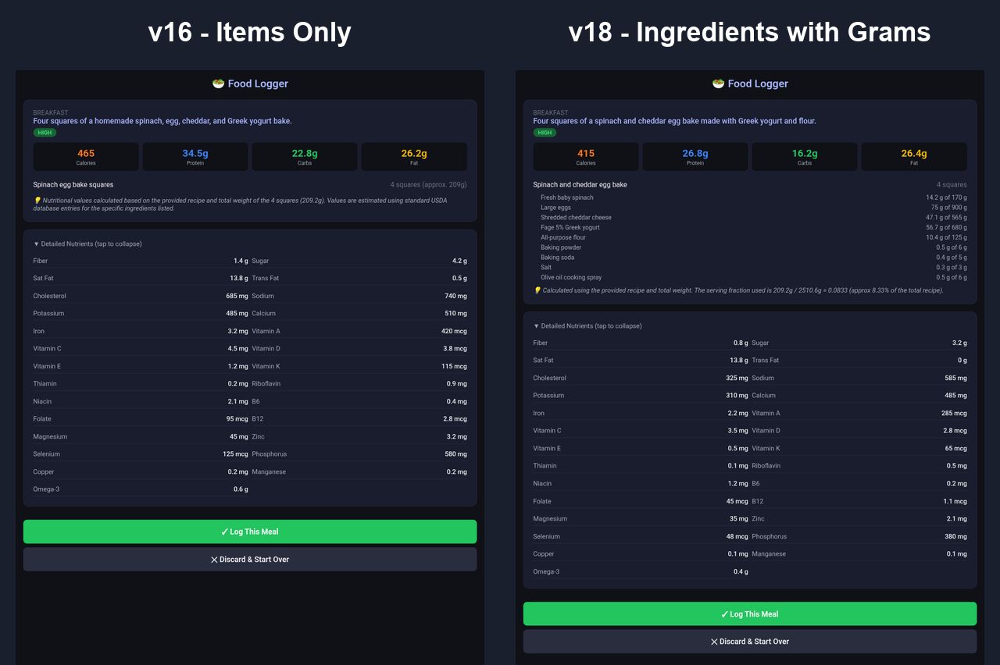

# Design Decisions

This is the longer version of the [Design Decisions](../README.md#design-decisions) section in the README. Each entry covers the problem, what I chose, what I considered instead, and the tradeoffs. Entries are grouped by part of the system rather than by the order I built them.

**Contents**
- [Architecture](#architecture)
  1. [One-tap water logging without building an app](#1-one-tap-water-logging-without-building-an-app)
  2. [One Apps Script project, two routes](#2-one-apps-script-project-two-routes)
  3. [Gemini-only first, USDA later](#3-gemini-only-first-usda-later)
- [Security & privacy](#security--privacy)
  4. [Narrowing the OAuth scope](#4-narrowing-the-oauth-scope)
  5. [A shared secret key as the gatekeeper](#5-a-shared-secret-key-as-the-gatekeeper)
  6. [No secrets or personal details in source](#6-no-secrets-or-personal-details-in-source)
- [Data model](#data-model)
  7. [One row per meal, units in the headers](#7-one-row-per-meal-units-in-the-headers)
  8. [A separate date column, written in the sheet's time zone](#8-a-separate-date-column-written-in-the-sheets-time-zone)
- [Food analysis](#food-analysis)
  9. [Prompting for consistent, parseable output](#9-prompting-for-consistent-parseable-output)
  10. [Retrying when Gemini is busy](#10-retrying-when-gemini-is-busy)
  11. [Review before commit](#11-review-before-commit)
  12. [Compressing photos in the browser](#12-compressing-photos-in-the-browser)
- [Bugs worth writing down](#bugs-worth-writing-down)
  13. [The "0 oz today" bug](#13-the-0-oz-today-bug)
  14. [The stuck "Logging..." button](#14-the-stuck-logging-button)
- [Accuracy testing](#accuracy-testing)
  15. [Measuring accuracy before adding USDA data](#15-measuring-accuracy-before-adding-usda-data)
  16. [The faster model over the more accurate one](#16-the-faster-model-over-the-more-accurate-one)
  17. [Tracking the prompt version automatically](#17-tracking-the-prompt-version-automatically)

---

## Architecture

### 1. One-tap water logging without building an app

**Problem.** Logging water in an app took too many taps (particularly since my cup holds 14 oz water and most logging apps assume 8 oz increments), came with ads, and kept the data on someone else's server. I wanted one tap from my Android home screen to add a row to my own Google Sheet containing exactly the volume of water that my cup or water bottle holds.

**Decision.** I deployed a Google Apps Script web app that appends a row when it receives a GET request. The open-source [HTTP Shortcuts](https://github.com/Waboodoo/HTTP-Shortcuts) app sends that request from a home-screen widget, with one shortcut per common volume (`?key=...&oz=14` for my standard drinking cup, `?key=...&oz=20` for the water bottle that I use when traveling). It shows the script's response as a toast, such as `14 oz · 56 oz today`.

**Alternatives considered.**
- **A Sheets home-screen widget.** Google's only Sheets widget creates a new spreadsheet. It can't append a row.
- **A Google Form with a pre-filled link.** This works with no code, but each log opens a browser tab and takes two taps. Submitting automatically with `formResponse` is unofficial and could stop working.
- **Tasker.** It's capable, but it's paid. HTTP Shortcuts is free, open source, and has no ads.
- **Rolling a rubber band up the side of a bottle for each refill.** Although the bands are cheap and easy, they'd slide down an angled cup, wouldn't feel good under my grip on the cup, and would catch on backpacks and cupholders when I travel.
- **Refilling my cup from a daily target-volume bottle or pitcher.** While this would reduce manual logging to once daily, it would also take up counter space, would break if visitors accidentally used it, and isn't portable for restaurants or travel.
- **Click a hand tally clicker each time I refill.** This is quick, easy, and inexpensive (under $5), but it would require keeping another thing on me at all times so that I don't forget to click it between refilling my cup and returning to my desk.
- **NFC Tag Tap.** Tapping an NFC tag sticker ($1/sticker) that triggers a background logging automation each time I refill would be fairly inexpensive and easy, but it would be another thing to keep on me at all times (unless I attach one to every cup and water bottle that I use so that it's connected to the drinking container).

**Tradeoffs.** This setup depends on a third-party Android app. It's also Android-specific.

### 2. One Apps Script project, two routes

**Problem.** The food logger needs an HTML page, while the water logger returns plain text. Apps Script allows only one script project bound to each spreadsheet.

**Alternatives considered.** I considered storing water logging data and nutrient logging data in separate Google Sheets, but decided I'd like to keep them in separate tabs of the same sheet to reduce overhead when I want to see the logs and summaries.

**Decision.** Both features share one project and one deployment URL. `doGet` checks the secret key first, then routes on a `page` parameter:

```javascript
if (e.parameter.page === 'food') {
  return HtmlService.createHtmlOutputFromFile('FoodLogger') /* ... */;
}
// otherwise: water logging
```

**Tradeoffs.** Every redeploy affects both features, so a mistake in food-logging code can break water logging. When changing functionality, I redeploy by editing the existing deployment to keep the URL the widgets depend on. I then re-test a water shortcut after each food-logging change.

### 3. Gemini-only first, USDA later

**Problem.** The most accurate source for nutrient values is the USDA FoodData Central database. However, matching AI-identified foods to USDA entries and scaling them by portion is a project in itself.

**Decision.** Phase 1 has Gemini estimate every nutrient directly. The JSON schema already records each item's name and `portion_grams` separately from the meal totals, and for mixed dishes, each ingredient's grams. In Phase 2, those ingredients can be looked up in USDA and replace Gemini's estimates where a good match exists. Accuracy testing later showed this is where the gain is: Gemini's ingredient amounts were more accurate than its nutrient totals (see #15).

**Alternatives considered.** I considered building the USDA lookup from the start. I chose to have a working tool sooner and to collect real meals to evaluate Phase 2 against.

**Tradeoffs.** Phase 1 values are model estimates, not values from a lab-tested database. See the README's Accuracy & Limitations section for more details on accuracy.

---

## Security & privacy

### 4. Narrowing the OAuth scope

**Problem.** On first deploy, the consent screen asked for permission to *"see, edit, create, and delete all your Google Sheets spreadsheets."* The script only needs one spreadsheet, and I'd rather not grant access beyond what's necessary.

**Decision.** I added the `/** @OnlyCurrentDoc */` annotation as the first line of `Code.gs`. Apps Script then requests access only to the spreadsheet the script is bound to.

**Note.** The "unverified app" warning remains, because the developer is me and the script isn't published to anyone else. That's expected for a personal script.

### 5. A shared secret key as the gatekeeper

**Problem.** The web app runs as me, with access set to "Anyone" so that the HTTP Shortcuts widget can call it without signing in. That means anyone who finds the URL could call it.

**Decision.** Every request must include a `key` parameter that matches the `SECRET_KEY` Script Property. If it doesn't, the script returns `no` and does nothing. The check runs before any routing, so it protects both features.

**Tradeoffs.** This is a shared secret in a URL, not real authentication. The key appears in browser history and in the address bar (I crop it out of screenshots). Anyone with the URL and key could append rows, see the current day's water total (which the toast returns after each entry), and run food analyses that use my Gemini API quota. They couldn't otherwise read the sheet or reach anything else in my account. For a personal logger that writes to a single spreadsheet, I judged that risk acceptable. If the key leaks, I change the Script Property and update the shortcuts.

### 6. No secrets or personal details in source

**Decision.** All configuration lives in **Script Properties**, Apps Script's built-in key-value store, which is separate from the code:

| Property | Purpose | If missing |
|---|---|---|
| `SECRET_KEY` | URL gatekeeper (see #5) | Every request returns `no` |
| `GEMINI_API_KEY` | Gemini API authentication | Analysis fails with a clear error |
| `GEMINI_MODEL` | Which Gemini model to call | Defaults to `gemini-3.1-flash-lite` |
| `HAND_LENGTH_INCHES` | Hand length for portion scale (see #9) | Defaults to `7` |

**Why.** The code can be published as-is. Switching models means editing a property instead of changing code. My hand measurement isn't committed to a public repo. Moving it into a property also fixed a unit mismatch: the prompt's inch and centimeter values didn't match. The code now takes inches and calculates the centimeters.

**A later correction.** The property was first called `HAND_SPAN_INCHES`, but I'd measured my hand's *length*, and my photos show it flat with the fingers together. A span (thumb to pinky, spread) isn't visible in those photos at all. So the number was right for the photos, but the label and prompt described a different dimension, and setting it to my real span would have made Gemini see everything about 20% too large. The property is now `HAND_LENGTH_INCHES`, and the prompt names the dimension the photo actually shows.

---

## Data model

### 7. One row per meal, units in the headers

**Decision.** Each logged meal is one row with 44 columns: timestamp, date, meal type, description, 31 nutrient totals, confidence and AI notes, a photo link reserved for Phase 3, and six tracking columns. The tracking columns record the item and ingredient breakdown, the model, my note, token usage, and a prompt fingerprint (see #17). Units appear in the header names, such as `Protein (g)` and `Folate (mcg DFE)`, so charts and pivot tables label themselves.

**Alternatives considered.** A long format, with one row per food item or per nutrient, would be more flexible to analyze. However, one row per meal is what I actually query: daily totals with `SUMIF` and weekly trends. It's also easy to read in the sheet.

**Tradeoffs.** `appendRow` writes by position, so the order of the `row` array in `logFoodToSheet()` must match the order of the sheet's columns. Reordering columns in the sheet requires a matching code change. The code comments label each value with its column letter to make that harder to get wrong.

### 8. A separate date column, written in the sheet's time zone

**Decision.** Both tabs store a full timestamp in column A and a date-only value in column B. The date is calculated in the spreadsheet's time zone, not the script's:

```javascript
const tz = ss.getSpreadsheetTimeZone();
const todayStr = Utilities.formatDate(now, tz, 'yyyy-MM-dd');
const day = Utilities.parseDate(todayStr, tz, 'yyyy-MM-dd');
```

**Why.** A clean date column makes daily totals a one-liner (`=SUMIF(Water!B:B, TODAY(), Water!C:C)`) and pivot tables easy. Using the spreadsheet's time zone, rather than the script's, means a late-evening drink or meal lands on the right day even if the two settings differ (see #13). The tradeoff is that dates follow the sheet's home time zone, not my location. When I travel, timestamps display in Central time, and an early breakfast in Europe or a late drink on the West Coast can land on a neighboring day.

**Related.** Summary formulas live on a separate tab. `appendRow` writes below the last non-empty row in *any* column, so a `QUERY` result spilling down the Water tab would push new entries below it.

---

## Food analysis

### 9. Prompting for consistent, parseable output

**Decision.** The prompt and request settings are tuned so the response can be parsed without special cases:
- **A fixed JSON schema** in the prompt, listing every nutrient key with its unit in the name (`sodium_mg`, `vitamin_d_mcg`).
- **`responseMimeType: "application/json"`** to force JSON output. The code still strips stray Markdown code fences before parsing, as a cheap safeguard.
- **`temperature: 0.2`** so the same photo gets similar estimates each time.
- **Rounding rules**: calories to the nearest 5, grams to one decimal place, and milligrams and micrograms to whole numbers. This keeps the sheet readable and avoids false precision.
- **A confidence rubric**: high for simple, clearly identifiable foods, medium for restaurant or partly hidden food, and low for complex mixed dishes. The page shows this as a badge on each result.
- **Scale references**: if a hand is visible, flat with the fingers together, Gemini uses its length as a ruler (from `HAND_LENGTH_INCHES`), along with plates, bowls, and utensils.
- **Context nudges**: restaurant food is assumed to use more butter, oil, and salt, and an optional note from me ("about 2 cups of stew") is added to the prompt.
- **An ingredient breakdown**: mixed dishes list their ingredients in grams, including likely hidden ones, each labeled `visible`, `inferred`, or `user` (from my note). This makes each estimate checkable: I can see what Gemini assumed was in the dish.
- **A recipe rule**: when my note includes a recipe, Gemini treats it as authoritative. It converts each ingredient to grams for the full recipe, takes my share from the recipe (servings or weights) rather than from the photo, and scales.
- **A defined failure case**: a photo with no food returns `{"error": "No food detected in this image"}`, which the page shows as an error instead of logging it.

**Why.** In one study of a general-purpose AI model, adding a text description of the meal reduced the average calorie error from about 30% to 24%, and to about 14% when ingredient amounts were included.[^1] The optional note is the cheapest way to provide that. The hand is my own addition: purpose-built food-imaging systems use a reference object of known size to set the scale, but I haven't found a study of whether it helps general-purpose models, and I haven't tested it separately.

### 10. Retrying when Gemini is busy

**Problem.** Gemini sometimes returns 503 or 429 errors that say the model is under high demand. Those errors often go away within seconds.

**Decision.** `analyzeFood` makes up to three attempts. It retries only errors that look temporary (status 503 or 429, or a "high demand" message), waiting 2 seconds and then 4 seconds. Other errors, like an invalid key, fail immediately and show Gemini's own error message.

**Tradeoffs.** In the worst case, a busy period adds about 6 seconds before the error appears. Apps Script's six-minute execution limit leaves plenty of room for that.

### 11. Review before commit

**Problem.** AI estimates are sometimes wrong, for example when a food is misidentified or a photo is blurry. A wrong row in the sheet is more annoying to fix than a wrong result on screen.

**Decision.** Analysis and logging are two separate server calls:
1. `analyzeFoodPhoto()` calls Gemini, saves the result in `CacheService` with a 10-minute expiry, and returns it to the page for review.
2. `confirmAndLog()` reads the cached analysis and appends the row. It runs only when I tap **Log This Meal**.

**Alternatives considered.** The page could send the analysis back to the server on confirm. Caching it on the server means the confirm step sends no data and logs exactly what Gemini returned, so nothing edited in the browser can reach the sheet.

**Tradeoffs.** There's a single cache slot, so a new analysis replaces any unconfirmed one. That suits logging one meal at a time. If I leave the review screen for more than 10 minutes, I have to analyze the photo again. Editing values before logging isn't supported, yet.

### 12. Compressing photos in the browser

**Problem.** Phone photos are typically 3–12 MB and about 4000×3000 pixels. Sending them as base64 through `google.script.run` is slow on mobile data. That resolution is also far more than Gemini needs to identify food.

**Decision.** Before uploading, the page draws the photo onto a `<canvas>`, scaling it to at most 1280 px on the longest side. It then re-encodes it as JPEG at 80% quality, which typically brings the upload to about 250 KB. The preview shown on screen is that same compressed image, so I see exactly what Gemini sees.

**Verification.** Apps Script serves pages inside nested iframes, so the browser's DevTools console starts in the wrong frame. Right-clicking the preview and choosing **Inspect** switches the console to the right frame. From there, `preview.naturalWidth` and `imageBase64.length` confirmed the dimensions and the upload size.

---

## Bugs worth writing down

### 13. The "0 oz today" bug

**Symptom.** The water toast always said `0 oz today`, even right after logging. The total didn't include the drink just logged.

**Root causes.** There were two, and both had to be fixed:
1. **Time zone mismatch.** The script built "today at midnight" in the script's time zone and compared it with exact timestamps read back from the sheet, which used the spreadsheet's time zone. Because the two settings differed slightly, the timestamps never matched. **Fix:** convert both dates to `yyyy-MM-dd` strings in the spreadsheet's time zone and compare those (see #8).
2. **`instanceof Date` failing.** Date values read back from a sheet didn't pass `instanceof Date` in this context, so the filter quietly dropped every row. **Fix:** check for the `getTime` method instead of the type (a "duck-typed" check):
   ```javascript
   const isDate = v => v && typeof v.getTime === 'function';
   ```

**Debugging technique.** While fixing it, I added a version tag to the toast (`v3 · ...`) to confirm the phone was calling the newly deployed code and not an older deployment. That ruled out a third possible cause before I changed anything else.

### 14. The stuck "Logging..." button

**Symptom.** After logging a meal and tapping **Log Another Meal**, the next analysis showed **Log This Meal** disabled, stuck on "Logging..." with a spinner. **Discard & Start Over** didn't fix it, but reloading the page did.

**Root cause.** `confirmLog()` disables the button and swaps in the spinner. On success, the page hides the results and shows the "Logged!" card, but it only restores the button on errors. `reset()` restored the Analyze button but never touched the Log button. So the button stayed hidden in its "Logging..." state and reappeared that way with the next analysis.

**Fix.** `reset()` now restores the Log button and also clears the previous meal's AI notes. Without that, a meal with no notes would have shown the previous meal's notes.

**Lesson.** When one function puts the UI into a temporary state, such as disabled or loading, the reset path has to undo it. That's easy to miss when the element is hidden rather than removed, because the stale state isn't visible until the element is shown again.

---

## Accuracy testing

### 15. Measuring accuracy before adding USDA data

**Problem.** Published studies give a rough idea of how accurate AI photo estimates are,[^2][^3] but not for my meals, my photos, or this prompt. Without a baseline, I couldn't tell whether a prompt change or Phase 2 actually helped.

**Decision.** I calculated the nutrients of two meals I eat often, overnight oats and an egg bake, from my recipes and USDA data. Then I analyzed the same photo of each under seven conditions, from photo only up to the full recipe with weights, 3 runs each, across three prompt versions. I scored each condition by mean absolute percent error (MAPE) and signed bias. The full write-up is in [accuracy-analysis.md](accuracy-analysis.md).

**What I found and changed.**
- **The photo can't show hidden ingredients.** Gemini never inferred the peanut butter in the oatmeal or the flour and yogurt in the egg bake, so photo-only estimates were 23–49% off. Naming the hidden ingredients in one line brought the oatmeal to 18%.
- **Ingredient lists made the errors explainable.** I added an ingredient breakdown to the prompt. It showed that Gemini estimated recipe proportions instead of calculating them, such as up to 3 times the actual oats. A recipe rule (convert to grams, then scale) fixed the ingredient amounts.
- **The totals don't follow the ingredients.** With the ingredient amounts right, Gemini's nutrient totals were still off. In one case, it reported 640 kcal for a serving whose own ingredient list adds up to about 400 kcal. That's the strongest argument for Phase 2: calculate the totals in code from the ingredient grams, rather than prompting harder.



**Tradeoffs.** Two meals with 3 runs each are case studies, not a benchmark. Run-to-run variation alone is about ±10%, so smaller differences between conditions aren't meaningful.

### 16. The faster model over the more accurate one

**Problem.** In testing, `gemini-3.8-flash` was far more accurate with a recipe (4–10% error) than `gemini-3.1-flash-lite` (8–79%, depending on the note).

**Decision.** I kept `gemini-3.1-flash-lite` in production and used 3.8 Flash only as a reference when testing prompt changes.

**Why.** 3.8 Flash often took over a minute per analysis, sometimes timed out after several minutes, and frequently hit high-traffic and quota errors. Flash-lite answers in seconds. A slow logger I stop using is less useful than a faster one I use every day. The accuracy gap is also the part that Phase 2 moves out of the model.

**Tradeoffs.** Until Phase 2 ships, estimates for recipes are less accurate than they could be. Because the model name is a Script Property (#6), switching back takes one edit and no redeploy.

### 17. Tracking the prompt version automatically

**Problem.** To compare accuracy across prompt versions, each logged row has to record which prompt produced it. Apps Script doesn't expose the deployment version to running code, and a version constant in the code is easy to forget to update.

**Decision.** The script hashes the prompt text (MD5, first 8 characters) and logs it in the Prompt Fingerprint column. It also logs the model, my note, token usage, and the item and ingredient breakdown. The fingerprint changes automatically whenever the prompt changes.

**Alternatives considered.** Reading the deployment version through the Apps Script API would need another OAuth scope and an API call on every analysis. A manual version constant depends on remembering it.

**Tradeoffs.** A fingerprint shows *that* the prompt changed, not *what* changed, so I keep a short log mapping fingerprints to prompt versions. It also changes when `HAND_LENGTH_INCHES` changes, since the hand length is part of the prompt text.

[^1]: Rodríguez-Jiménez M et al. (2025). Image-Based Dietary Energy and Macronutrients Estimation with ChatGPT-5. *Nutrients* 17(22):3613. https://doi.org/10.3390/nu17223613
[^2]: Fridolfsson J et al. (2025). Performance Evaluation of 3 Large Language Models for Nutritional Content Estimation from Food Images. *Current Developments in Nutrition* 9(10):107556. https://doi.org/10.1016/j.cdnut.2025.107556
[^3]: Shonkoff E et al. (2023). AI-based digital image dietary assessment methods compared to humans and ground truth: a systematic review. *Annals of Medicine* 55(2):2273497. https://doi.org/10.1080/07853890.2023.2273497
